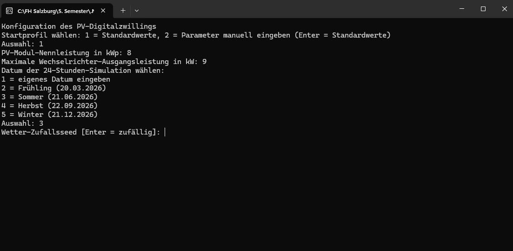
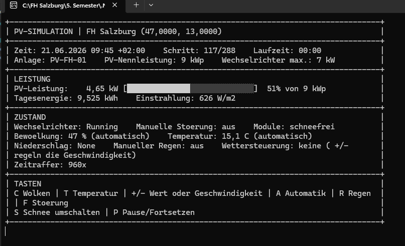

# Entwicklungsjournal - Nikolas Giesen

## 2026-10-04 - Grundgerüst PV-Modell und erster Simulationslauf

-**Done:** ´PvSimulator`erstellt; Eingabe jeglicher Paramter; simuliert 24h in eingegebener Schrittweite

-**KI:** Github Copilot GPT-6 Luna => erstellen des Grundgerüsts

-**Artefacts:** 'PV_Simulator\Domain\Location.cs', 'PV_Simulator\Domain\PvArray.cs', 'PV_Simulator\Domain\Inverter.cs', 'PV_Simulator\Domain\InverterStatus.cs', 'PV_Simulator\Domain\WeatherConditions.cs', 'PV_Simulator\Domain\SimulationSettings.cs', 'PV_Simulator\Domain\SimulationSnapshot.cs', 'PV_Simulator\Calculations\SolarPosition.cs', 'PV_Simulator\Calculations\SolarPositionCalculator.cs', 'PV_Simulator\Calculations\PvPowerCalculator', 'PV_Simulator\Climate\SnowClimateDataset.cs', 'PV_Simulator\Climate\SnowClimateDataLoader.cs', 'PV_Simulator\Climate\SnowClimatology.cs', 'PV_Simulator\Simulation\SnowCoverModel.cs', 'PV_Simulator\Simulation\SimulationEngine.cs', 'PV_Simulator\ConsoleApp\ConsoleInput.cs', 'PV_Simulator\ConsoleApp\ConsoleStatusRenderer.cs', 'PV_Simulator\Simulation\SimulationRunnder.cs'

## 2026-10-05 - Standarteingabewerte, CSV Export, Wetterautomatisierung

-**Done:** Es gibt es Standartwerte um nicht immer alles einzugeben, Wetter, Regen und Temperatur sind automatisch am Tag änderbar

-**KI:** Github Copilot GPT-6 Luna => export des CSV Datei, Eingabeänderung, Simuliertes Wetter

-**Artefacts:** 'PV_Simulator\Domain\SimulationConfiguration.cs', 'PV_Simulator\Domain\SimulationDefaults.cs', 'PV_Simulator\Domain\WeatherConditions.cs', 'PV_Simulator\Domain\PvArray.cs', 'PV_Simulator\Domain\Inverter.cs', 'PV_Simulator\Domain\SimulationSnapshot.cs', 'PV_Simulator\Domain\WeatherSettings.cs', 'PV_Simulator\ConsoleApp\ConsoleInput.cs', 'PV_Simulator\ConsoleApp\ConsoleStatusRenderer.cs', 'PV_Simulator\ConsoleApp\SimulationDateSelector.cs', 'PV_Simulator\Calculations\PvPowerCalculator.cs', 'PV_Simulator\Simulation\SimulationEngine.cs', 'PV_Simulator\Simulation\SimulationRunner.cs', 'PV_Simulator\Simulation\CsvSimulationLogger.cs', 'PV_Simulator\Simulation\DeviceIdLease.cs', 'PV_Simulator\Simulation\SnowCoverModel.cs', 'PV_Simulator\Weather\WeatherEngine.cs', 'PV_Simulator\Program.cs', 'PV_Simulator\PROJEKTKONTEXT.md'

## 2026-10-06 - Dynamischer Leistungsbalken

-**Done:** Die Konsolenausgabe zeigt jetzt eine schönere Darstellung an.

-**KI:** Github Copilot GPT-6 Luna => Leistungsbalken im ConsoleStatusRenderer integrieren und Simulationsschleife für sichtbare Aktualisierung takten

-**Artefacts:** 'PV_Simulator\ConsoleApp\ConsoleStatusRenderer.cs', 'PV_Simulator\Simulation\SimulationRunner.cs', 'PV_Simulator\Program.cs'

### Trennung der Anlagen-Nennleistungen

-**Done:** PV-Leistung in kWp und Wechselrichter-Ausgangsleistung in kW getrennt; beide werden interaktiv abgefragt.

-**KI:** Github Copilot GPT-6 Luna => Hardwareleistungen und Einheiten korrekt modellieren.

-**Artefacts:** 'PV_Simulator\Domain\SimulationDefaults.cs', 'PV_Simulator\ConsoleApp\ConsoleInput.cs', 'PV_Simulator\Domain\PvArray.cs', 'PV_Simulator\Calculations\PvPowerCalculator.cs', 'PV_Simulator\ConsoleApp\ConsoleStatusRenderer.cs', 'PV_Simulator\Simulation\CsvSimulationLogger.cs'

-**Konsolenausgabe:**

### Manuelle Schneesteuerung

-**Done:** Automatische Schneedaten entfernt; Taste S toggelt die vollständige PV-Modulbedeckung und CSV protokolliert den Status.

-**KI:** Github Copilot GPT-6 Luna => Schneemodell vereinfachen und manuelle Steuerung ergänzen.

-**Artefacts:** 'PV_Simulator\Program.cs', 'PV_Simulator\PV_Simulator.csproj', 'PV_Simulator\Domain\WeatherConditions.cs', 'PV_Simulator\Domain\SimulationSnapshot.cs', 'PV_Simulator\Calculations\PvPowerCalculator.cs', 'PV_Simulator\ConsoleApp\ConsoleInput.cs', 'PV_Simulator\ConsoleApp\ConsoleStatusRenderer.cs', 'PV_Simulator\Simulation\SimulationEngine.cs', 'PV_Simulator\Simulation\SimulationRunner.cs', 'PV_Simulator\Simulation\CsvSimulationLogger.cs'

-**Konsolenausgabe:**

### ASCII-Dashboard für die Simulation

-**Done:** Simulationswerte und Tastenkürzel sind farblos in einer umbruchfähigen ASCII-Box mit Leistungsbalken gruppiert.

-**KI:** Github Copilot GPT-6 Luna => Laufende Konsolenausgabe übersichtlicher anordnen.

-**Artefacts:** 'PV_Simulator\ConsoleApp\ConsoleStatusRenderer.cs'

-**Konsolenausgabe:**

